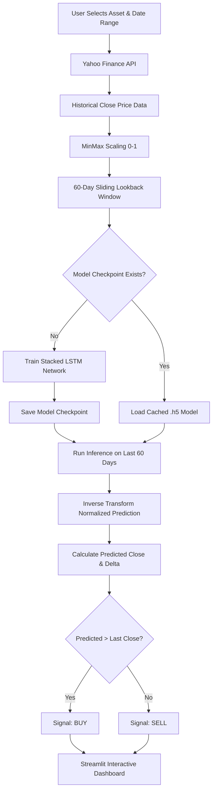

# 📈 AI Stock Trading & Price Predictor

<p align="center">
  
  
  
  
  
  
</p>

<p align="center">
  An end-to-end algorithmic trading and deep learning forecasting dashboard built with <b>Streamlit</b> and <b>TensorFlow / Keras LSTM</b> networks. Streams real-time market data via <b>Yahoo Finance</b>, forecasts the next closing price using sequential time-series modeling, and produces automated quantitative trading signals (Buy/Sell).
</p>

---

## 📑 Table of Contents

- [Overview](#-overview)
- [Key Features](#-key-features)
- [System Architecture](#-system-architecture)
- [Deep Learning Model Architecture](#-deep-learning-model-architecture)
- [Supported Financial Instruments](#-supported-financial-instruments)
- [Project Directory Structure](#-project-directory-structure)
- [Getting Started](#-getting-started)
  - [Prerequisites](#prerequisites)
  - [Installation](#installation)
- [Running the Application](#-running-the-application)
- [Step-by-Step GitHub Setup & Push Guide](#-step-by-step-github-setup--push-guide)
- [Configuration & Hyperparameters](#-configuration--hyperparameters)
- [Disclaimer](#-disclaimer)
- [License](#-license)

---

## 🔍 Overview

This application bridges quantitative finance and deep learning by utilizing **Long Short-Term Memory (LSTM)** neural networks to model sequential dependencies in historical stock price movements.

Users can choose from a range of equities, indices, and funds across global and domestic markets. The application checks whether a pre-trained model checkpoint exists on disk for the asset:
- If **found**, it swiftly loads the weights to generate immediate inference.
- If **absent**, it dynamically compiles and trains a custom 2-layer stacked LSTM network directly in the session, caching the model file (`.h5`) for future runs.

> [!NOTE]  
> The repository includes both the core model interface (`app.py`) and an extended version (`app1.py`) featuring session authentication, descriptive statistical analysis, raw dataset exploration, and historical matplotlib trends.

---

## ✨ Key Features

| Feature | Description |
| :--- | :--- |
| **Real-Time Market Ingestion** | Integrates with Yahoo Finance (`yfinance`) for high-resolution historical and intraday data fetching. |
| **Custom Lookback Processing** | Applies dynamic `MinMaxScaler` normalization and constructs sliding 60-day temporal lookback sequences. |
| **Stacked LSTM Engine** | Deep recurrent neural network built with TensorFlow/Keras capable of capturing complex non-linear time-series trends. |
| **Instant / Cached Inference** | Checks local cache for `.h5` model files to avoid redundant training overhead. |
| **Simulated Trading Signals** | Compares predicted forward-looking closing price against latest close to yield automated `BUY` / `SELL` signals with delta metrics. |
| **Interactive Visualization** | Real-time Streamlit charts, interactive historical price inspection, and technical Matplotlib subplots. |
| **Authentication Barrier** | Built-in session state authentication mechanism (in `app1.py`) for access control. |

---

## 🏗 System Architecture



---

## 🧠 Deep Learning Model Architecture

The neural network is optimized for sequential financial time-series forecasting:

```
Input Shape: (Batch_Size, 60 Timesteps, 1 Feature)
│
├── [Layer 1] LSTM (units=50, return_sequences=True)
├── [Layer 2] Dropout (rate=0.2)
├── [Layer 3] LSTM (units=50, return_sequences=False)
├── [Layer 4] Dropout (rate=0.2)
├── [Layer 5] Dense (units=25, activation='linear')
└── [Layer 6] Dense (units=1, activation='linear')
```

### Specifications & Hyperparameters

| Hyperparameter | Value | Description |
| :--- | :--- | :--- |
| **Lookback Window** | `60 Days` | Historical context utilized per forecast step |
| **Batch Size** | `16` | Samples processed per gradient update |
| **Epochs** | `10` | Iterations over entire training dataset |
| **Optimizer** | `Adam` | Adaptive learning rate optimization |
| **Loss Function** | `Mean Squared Error (MSE)` | Regression loss metric |
| **Dropout Regularization** | `20%` | Prevents overfitting on noise in market data |

---

## 🌐 Supported Financial Instruments

The platform includes pre-configured mappings across diversified asset classes:

- **US Equities**: Apple (`AAPL`), Alphabet (`GOOG`), Microsoft (`MSFT`), Amazon (`AMZN`), BlackRock (`BLK`)
- **Global & Domestic Indices**: Nifty 50 (`^NSEI`)
- **Indian Equities**: Tata Steel (`TATASTEEL.NS`), Larsen & Toubro (`LT.NS`)
- **Mutual Funds / Fixed Income**: Nippon India Ultra Short Duration Fund (`0P0001BB3Y.BO`)

---

## 📁 Project Directory Structure

```text
├── app.py                                                      # Clean Streamlit trading predictor
├── app1.py                                                     # Feature-rich app with login & analytics
├── requirements.txt                                            # Project dependencies
├── .gitignore                                                  # Standard Python/OS ignore rules
├── README.md                                                   # Project documentation
│
├── Models (Pre-trained Weights)
│   ├── AAPL_lstm_model.h5
│   ├── GOOG_lstm_model.h5
│   ├── BlackRock, Inc. (BLK)_lstm_model.h5
│   ├── Nifty 50 (NSEI)_lstm_model.h5
│   ├── Nippon India Ultra Short Duration Fund (0P0001BB3Y.BO)_lstm_model.h5
│   ├── TATASTEEL.NS_lstm_model.h5
│   └── lstm_model.h5
```

---

## 🚀 Getting Started

### Prerequisites

Ensure you have Python 3.9 through Python 3.11 installed.

```bash
python3 --version
git --version
```

### Installation

1. **Clone the repository:**
   ```bash
   git clone https://github.com/vedant-thakker/stock-trading-predictor.git
   cd stock-trading-predictor
   ```

2. **Create and activate a virtual environment:**
   ```bash
   # On macOS / Linux:
   python3 -m venv venv
   source venv/bin/activate

   # On Windows:
   python -m venv venv
   venv\Scripts\activate
   ```

3. **Install the required dependencies:**
   ```bash
   pip install --upgrade pip
   pip install -r requirements.txt
   ```

---

## 🖥 Running the Application

You can launch either application depending on your workflow:

### Option 1: Standard Dashboard
Direct predictor focusing on live prices, model training/inference, and trading decisions:
```bash
streamlit run app.py
```

### Option 2: Full-Featured Dashboard (Recommended)
Includes login authentication, raw data exploration tables, summary statistics, and trend visualizations:
```bash
streamlit run app1.py
```

> **Note on Login (`app1.py`):** Enter any non-empty username and password to proceed into the interactive dashboard.

---

## 📤 Step-by-Step GitHub Setup & Push Guide

Follow these commands to push this codebase directly to GitHub:

### 1. Initialize Git and Stage Files
```bash
git init
git add .
git commit -m "feat: initial commit with LSTM models, Streamlit dashboard and documentation"
```

### 2. Rename Default Branch to `main`
```bash
git branch -M main
```

### 3. Create a Remote Repository on GitHub
1. Go to [GitHub - New Repository](https://github.com/new).
2. Choose a repository name (e.g. `stock-price-lstm-predictor` or `trading-bot`).
3. Leave **"Initialize this repository with a README"** **UNCHECKED** (since you already have this README).
4. Click **Create repository**.

### 4. Link Remote and Push
Copy your repository URL from GitHub and run:

```bash
git remote add origin https://github.com/vedant-thakker/stock-trading-predictor.git
git push -u origin main
```

---

## ⚙️ Configuration & Hyperparameters

You can customize prediction parameters directly inside `app.py` or `app1.py`:

- **Change Lookback Window**: Edit `lookback = 60` (e.g., set to `30` or `90` days).
- **Modify Training Epochs**: Update `model.fit(..., epochs=10, batch_size=16)` to optimize convergence.
- **Add New Tickers**: Add ticker keys and Yahoo Finance symbols to the `stock_ticker_map` dictionary:
  ```python
  stock_ticker_map["Tesla"] = "TSLA"
  ```

---

## ⚠️ Disclaimer

> [!CAUTION]  
> This project was developed solely for **educational, academic, and experimental purposes**. Financial markets are influenced by macroeconomic factors, liquidity risks, sentiment, and unexpected events that cannot be purely forecasted by historical time-series price data alone. **Do not use this system as financial advice or for executing live capital trades.**

---

## 📜 License

This project is open-source and distributed under the [MIT License](LICENSE).
